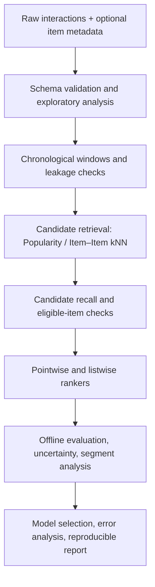

<div align="center">

<sub>APPLIED DATA SCIENCE · RECOMMENDER SYSTEMS · EXPERIMENTAL MACHINE LEARNING</sub>

<h1>Recommender Systems:<br>From Retrieval to Learning-to-Rank</h1>

<p><strong>A reproducible benchmark across collaborative filtering, implicit feedback, and metadata-aware ranking.</strong></p>

<p>
  
  
  
  
</p>

<p><em>Designed as an applied Data Science case study. No benchmark results are claimed until the pipelines have been implemented and run.</em></p>

</div>

---

<table>
<thead>
<tr><th colspan="3" align="center">Three Complementary Recommendation Settings</th></tr>
</thead>
<tbody>
<tr>
<td align="center" width="33%"><strong>01 · MovieLens 1M</strong><br><sub>Movie ratings</sub><br><br>Explicit feedback<br>Collaborative filtering<br>Controlled baselines</td>
<td align="center" width="33%"><strong>02 · RetailRocket</strong><br><sub>E-commerce events</sub><br><br>Views, carts, purchases<br>Implicit feedback<br>Sparsity and cold start</td>
<td align="center" width="33%"><strong>03 · Amazon Reviews '23</strong><br><sub>Video Games · 5-core</sub><br><br>Ratings and timestamps<br>Item metadata<br>Feature-rich ranking</td>
</tr>
</tbody>
</table>

<table>
<tbody>
<tr>
<td align="center" width="25%"><strong>3</strong><br><sub>Data domains</sub></td>
<td align="center" width="25%"><strong>2</strong><br><sub>Recommendation stages</sub></td>
<td align="center" width="25%"><strong>3</strong><br><sub>Modeling paradigms</sub></td>
<td align="center" width="25%"><strong>4</strong><br><sub>Core top-K metrics</sub></td>
</tr>
</tbody>
</table>

<div align="center">
<a href="#-at-a-glance">At a glance</a> ·
<a href="#-three-datasets">Datasets</a> ·
<a href="#-study-design">Study design</a> ·
<a href="#-models-and-evaluation">Models & evaluation</a> ·
<a href="#-step-by-step">Step by step</a> ·
<a href="#-project-structure">Structure</a> ·
<a href="#-data-sources-and-attribution">Sources</a>
</div>

---

## ◆ At a glance

A recommendation model can perform well on a small offline benchmark and still fail to improve a real product. Candidate-generation limitations, temporal leakage, biased observations, cold-start users, and inference costs all affect whether ranking improvements are meaningful.

This project investigates a practical question:

> **When does adding a supervised learning-to-rank stage improve recommendations over simpler retrieval methods—and what does that improvement cost?**

The planned experimental pipeline covers the full applied Data Science workflow: **data understanding → feature engineering → candidate retrieval → ranking → rigorous offline evaluation → reproducibility and inference trade-offs**.

**The scientific goals are to:**

1. Establish strong non-personalized and collaborative-filtering baselines before introducing complex models.
2. Compare *pointwise* scoring methods with a ranking-specific objective, using the same candidate sets and temporal protocol.
3. Quantify the effects of candidate recall, engineered features, user/item sparsity, and model complexity.
4. Report uncertainty, failure cases, computational cost, and limitations—not just the best score.

> [!IMPORTANT]
> **Project status — design phase.** This README specifies the target study and its future command-line interface. Only environment setup and manual dataset acquisition are executable at this stage. Training commands below are **planned**, not yet implemented. There are no validated results, deployed APIs, or completed experiments to report.

## ◆ Three datasets

The datasets are intentionally different. We will **compare models within each dataset**, not aggregate their scores into one misleading cross-domain leaderboard.

| Dataset | Source and approximate size | Signal and prediction target | What it helps test |
|:---|:---|:---|:---|
| **MovieLens 1M** | [GroupLens](https://grouplens.org/datasets/movielens/1m/) · ~1 million ratings | Explicit movie ratings with timestamps; a documented positive-relevance threshold (initial proposal: rating ≥ 4) | Popularity, item–item kNN, collaborative filtering, ranking baselines |
| **RetailRocket** | [RetailRocket on Kaggle](https://www.kaggle.com/datasets/retailrocket/ecommerce-dataset) · ~2.7 million behavioral events | Views, add-to-cart, and transaction events; **separate task definitions** for next interaction and stronger-intent behavior | Implicit feedback, event weighting, severe sparsity, item availability and cold start |
| **Amazon Reviews '23 — Video Games (5-core)** | [McAuley Lab 5-core benchmarks](https://amazon-reviews-2023.github.io/data_processing/5core.html) · ~815 thousand ratings | Ratings and timestamps, optionally joined to [product metadata](https://amazon-reviews-2023.github.io/main.html) | Metadata-aware features, categorical signals, pointwise vs. listwise ranking |

### Important dataset-specific caveats

- **MovieLens:** ratings are observed preferences, not a log of every item the user saw. Unrated items must **not** automatically be interpreted as known dislikes.
- **RetailRocket:** a view, an add-to-cart event, and a purchase represent different types of behavior. We will avoid collapsing them into one target without explicitly describing the task and its biases. Very short histories will be analyzed separately.
- **Amazon 5-core:** prefiltering users/items with at least five interactions changes the population and makes the benchmark more warm-start-friendly. We will disclose that selection bias. Metadata must be joined by valid product identifiers and treated consistently with time availability.

**Local development fixtures.** Small synthetic or sample files (for example, `interactions_tiny.csv` and `interactions_sample.csv`) can be used for unit tests and debugging once their schema and provenance are checked. They will **not** be presented as evidence of recommendation quality.

## ◆ Study design

The benchmark is built around time-aware evaluation and clear separation of model training, selection, and final assessment.



### 1 · Chronological evaluation

The **primary protocol** will use chronological windows with explicit boundaries:

| Window | Purpose | Data-access rule |
|:---|:---|:---|
| **Retrieval history** | Fit initial candidate generators and historical features | Only events available before the ranker-label window |
| **Ranker training** | Create labeled candidate groups and train rankers | Candidate and feature snapshots must predate each target event |
| **Validation** | Select hyperparameters, blending strategies, and thresholds | No data from the final test period |
| **Test** | One-time final evaluation of locked configurations | No tuning after inspecting test outcomes |

A **per-user leave-last-out split** may be included as a secondary, clearly labeled research protocol. Its results must not be conflated with the globally chronological evaluation.

The implementation must explicitly handle users or items that first appear after a cutoff, avoid using future item properties, and report how many evaluation examples are eligible for personalized vs. fallback recommendations.

### 2 · Two-stage recommendation

<table>
<thead><tr><th width="50%">Stage A — Candidate retrieval</th><th width="50%">Stage B — Re-ranking</th></tr></thead>
<tbody><tr>
<td><strong>Goal:</strong> find a manageable set of potentially relevant items.<br><br><strong>Baselines:</strong> global popularity; item–item collaborative kNN.<br><br><strong>Key constraint:</strong> filter previously consumed/ineligible items and measure candidate recall before ranking.</td>
<td><strong>Goal:</strong> order a fixed candidate set according to predicted relevance.<br><br><strong>Baselines:</strong> Logistic Regression and gradient-boosted classifiers.<br><br><strong>Ranking-aware method:</strong> LightGBM LambdaMART, grouped by user or query context.</td>
</tr></tbody>
</table>

Negative examples for pointwise training will be selected from **historically eligible candidate pools**, with recorded sampling policy and random seed. In implicit-feedback settings, unobserved items are **unlabeled**, not confirmed negatives; the limitation will be stated when interpreting results.

### 3 · Research questions

| ID | Question | Planned experiment |
|:---|:---|:---|
| **RQ1** | How much relevance is lost before ranking? | Candidate Recall@N vs. final NDCG@K |
| **RQ2** | Does a ranking-specific objective beat pointwise classification? | Matched candidate sets and chronological evaluation |
| **RQ3** | Which features help, and under what conditions? | Feature-group ablations with comparable model selection |
| **RQ4** | Where do models fail? | User activity, item popularity, new-item/new-user segments |
| **RQ5** | Is the incremental gain operationally worthwhile? | Quality, model size, training cost, P50/P95 inference latency |

## ◆ Models and evaluation

### Planned model comparison

| Family | Model | Role |
|:---|:---|:---|
| Heuristic | **Popularity** | Strong non-personalized baseline and fallback |
| Collaborative filtering | **Item–Item kNN** | Personalized candidate retrieval baseline |
| Pointwise ML | **Logistic Regression** | Interpretable supervised scoring baseline |
| Pointwise ML | **LightGBM Classifier / XGBoost Classifier** | Nonlinear supervised scoring comparison |
| Listwise-oriented ML | **LightGBM LambdaMART** | Optimizes a ranking-focused objective using grouped candidate lists |

**Primary metric:** `NDCG@10` for top-K ranking quality, reported separately for each dataset and target definition.

**Supporting metrics:** `Recall@10`, `Precision@10`, `MAP@10`, `Candidate Recall@N`, catalog coverage, user coverage, and inference latency. Where valid, we will estimate **95% paired-bootstrap confidence intervals at the user level**, include per-segment results, and publish feature-ablation tables.

Evaluation will account for duplicate recommendations, empty histories, unavailable items, stable ranking tie-breaks, and candidate eligibility. **Offline ranking gains do not establish a causal lift in CTR, bookings, or purchases.** That requires suitable online experimentation or counterfactual evaluation data.

### Expected research artifacts — not yet produced

- Dataset cards with schema, timestamps, sparsity, missingness, and preprocessing decisions.
- Reproducible configuration files, random seeds, and frozen environment details.
- Per-dataset model tables with confidence intervals and candidate-stage diagnostics.
- Feature-importance and ablation analyses; documented data and evaluation limitations.
- A saved inference pipeline and a small demonstration API after benchmark validation.

## ◆ Step by step

The steps below are the **intended reproducible user journey**. Steps 1–2 can be performed now. Steps 3–7 describe the **planned CLI contract** and will become executable as the implementation is added.

### Step 1 — Create the Python environment · available now

**Requirements:** Python 3.11+ and a local machine with sufficient memory for the selected dataset. MovieLens 1M is the recommended starting point.

```bash
python3 -m venv .venv
source .venv/bin/activate
python -m pip install --upgrade pip
python -m pip install -r requirements.txt
```

On Windows, activate the environment using `.venv\Scripts\activate` instead.

> **macOS note:** LightGBM may require the OpenMP runtime (`brew install libomp`). This is a platform dependency, not an extra Python package.

### Step 2 — Obtain the datasets · available now

Download the data from their **original publishers** and place the extracted source files under the following paths:

```text
data/
└── raw/
    ├── movielens-1m/
    │   └── ml-1m/
    │       ├── ratings.dat
    │       └── movies.dat
    ├── retailrocket/
    │   ├── events.csv
    │   ├── item_properties_part1.csv      # optional metadata extension
    │   ├── item_properties_part2.csv      # optional metadata extension
    │   └── category_tree.csv              # optional metadata extension
    └── amazon-video-games/
        ├── Video_Games.csv                # 5-core rating-only data
        └── meta_Video_Games.jsonl.gz      # optional raw metadata
```

**Sources:** [MovieLens 1M](https://grouplens.org/datasets/movielens/1m/) · [RetailRocket](https://www.kaggle.com/datasets/retailrocket/ecommerce-dataset) · [Amazon Reviews '23: 5-core](https://amazon-reviews-2023.github.io/data_processing/5core.html) and [item metadata](https://amazon-reviews-2023.github.io/main.html).

File names and paths will be validated by dataset adapters. For Amazon, keep the original rating-only file and optional metadata files distinct; do not combine them manually. **Raw datasets should not be committed to GitHub.** Review each publisher's terms before use or redistribution.

### Step 3 — Validate and prepare a dataset · planned

```bash
python -m recsys.cli validate --dataset movielens-1m
python -m recsys.cli prepare  --dataset movielens-1m
```

Target outputs: validated schema, chronological statistics, train/validation/test manifests, and processed Parquet datasets. The `prepare` command will also document event-to-label conversion and unknown-user/item policies.

### Step 4 — Perform exploratory data analysis · planned

```bash
python -m recsys.cli analyze --dataset movielens-1m
```

Target outputs: user/item activity distributions, sparsity, time coverage, repeat interactions, target balance, and missingness. The same analysis will be applied to all three datasets with dataset-specific diagnostics.

### Step 5 — Run retrieval baselines · planned

```bash
python -m recsys.cli benchmark --dataset movielens-1m --stage retrieval
```

Target outputs: popularity and item–item kNN results, candidate recall, eligible-item coverage, and computational cost.

### Step 6 — Train and compare ranking models · planned

```bash
python -m recsys.cli benchmark --dataset movielens-1m --stage ranking
```

Target outputs: pointwise vs. LambdaMART comparison on fixed candidate pools, validation-only model selection, per-user/group diagnostics, and test metrics from a locked configuration.

### Step 7 — Reproduce the study across all three domains · planned

```bash
python -m recsys.cli benchmark --dataset movielens-1m      --stage all
python -m recsys.cli benchmark --dataset retailrocket      --stage all
python -m recsys.cli benchmark --dataset amazon-video-games --stage all
python -m recsys.cli report --dataset all
```

Target outputs: `reports/<dataset>/` tables and plots, dataset-specific uncertainty intervals, ablations, latency measurements, and documented limitations. **Do not interpret absolute NDCG values across different datasets as a single leaderboard.**

## ◆ Project structure

**Target layout (to be created in subsequent implementation steps):**

```text
recsys-ranking-benchmark/
├── README.md
├── requirements.txt
├── data/
│   ├── raw/                    # external datasets; gitignored
│   └── fixtures/               # small test-only inputs
├── recsys/
│   ├── cli.py
│   ├── datasets/               # source-specific adapters
│   ├── validation.py
│   ├── splitting.py
│   ├── retrieval.py
│   ├── candidates.py
│   ├── features.py
│   ├── ranking.py
│   ├── evaluation.py
│   └── experiments.py
├── configs/
│   ├── movielens-1m.yaml
│   ├── retailrocket.yaml
│   └── amazon-video-games.yaml
├── tests/
├── notebooks/                  # EDA only; no hidden pipeline logic
├── reports/                    # reproducible metrics and figures
└── artifacts/                  # trained models and feature schemas
```

## ◆ Data sources and attribution

- **MovieLens 1M:** GroupLens Research, University of Minnesota. [Dataset and usage terms](https://grouplens.org/datasets/movielens/1m/). See Harper and Konstan, *The MovieLens Datasets: History and Context*, ACM TiiS (2015).
- **RetailRocket:** anonymized e-commerce behavior dataset published by RetailRocket on [Kaggle](https://www.kaggle.com/datasets/retailrocket/ecommerce-dataset). Follow the publisher's distribution terms.
- **Amazon Reviews 2023:** McAuley Lab. [Official documentation, data processing, and citation](https://amazon-reviews-2023.github.io/main.html). See Hou et al., *Bridging Language and Items for Retrieval and Recommendation* (2024).

**Data ethics and reproducibility:** data publishers retain their own terms; this repository will distribute **source code and reproducible instructions**, not third-party raw datasets. Results, when available, will identify exact source versions, filtering, split boundaries, seeds, hardware, and package versions.
