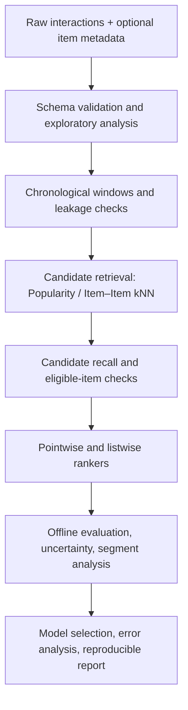

<div align="center">

<sub>APPLIED DATA SCIENCE · RECOMMENDER SYSTEMS · EXPERIMENTAL MACHINE LEARNING</sub>

<h1>Recommender Systems:<br>From Retrieval to Learning-to-Rank</h1>

<p><strong>A reproducible benchmark across collaborative filtering, implicit feedback, and metadata-aware ranking.</strong></p>

<p>
  
  
  
  
</p>

<p><em>Designed as an applied Data Science case study. No benchmark results are claimed until the pipelines have been implemented and run.</em></p>

</div>

---

<table>
<thead>
<tr><th colspan="3" align="center">Three Complementary Recommendation Settings</th></tr>
</thead>
<tbody>
<tr>
<td align="center" width="33%"><strong>01 · MovieLens 1M</strong><br><sub>Movie ratings</sub><br><br>Explicit feedback<br>Collaborative filtering<br>Controlled baselines</td>
<td align="center" width="33%"><strong>02 · RetailRocket</strong><br><sub>E-commerce events</sub><br><br>Views, carts, purchases<br>Implicit feedback<br>Sparsity and cold start</td>
<td align="center" width="33%"><strong>03 · Amazon Reviews '23</strong><br><sub>Video Games · 5-core</sub><br><br>Ratings and timestamps<br>Item metadata<br>Feature-rich ranking</td>
</tr>
</tbody>
</table>

<table>
<tbody>
<tr>
<td align="center" width="25%"><strong>3</strong><br><sub>Data domains</sub></td>
<td align="center" width="25%"><strong>2</strong><br><sub>Recommendation stages</sub></td>
<td align="center" width="25%"><strong>3</strong><br><sub>Modeling paradigms</sub></td>
<td align="center" width="25%"><strong>4</strong><br><sub>Core top-K metrics</sub></td>
</tr>
</tbody>
</table>

<div align="center">
<a href="#-at-a-glance">At a glance</a> ·
<a href="#-three-datasets">Datasets</a> ·
<a href="#-study-design">Study design</a> ·
<a href="#-models-and-evaluation">Models & evaluation</a> ·
<a href="#-step-by-step">Step by step</a> ·
<a href="#-project-structure">Structure</a> ·
<a href="#-data-sources-and-attribution">Sources</a>
</div>

---

## ◆ At a glance

A recommendation model can perform well on a small offline benchmark and still fail to improve a real product. Candidate-generation limitations, temporal leakage, biased observations, cold-start users, and inference costs all affect whether ranking improvements are meaningful.

This project investigates a practical question:

> **When does adding a supervised learning-to-rank stage improve recommendations over simpler retrieval methods—and what does that improvement cost?**

The planned experimental pipeline covers the full applied Data Science workflow: **data understanding → feature engineering → candidate retrieval → ranking → rigorous offline evaluation → reproducibility and inference trade-offs**.

**The scientific goals are to:**

1. Establish strong non-personalized and collaborative-filtering baselines before introducing complex models.
2. Compare *pointwise* scoring methods with a ranking-specific objective, using the same candidate sets and temporal protocol.
3. Quantify the effects of candidate recall, engineered features, user/item sparsity, and model complexity.
4. Report uncertainty, failure cases, computational cost, and limitations—not just the best score.

> [!IMPORTANT]
> **Project status — design phase.** This README specifies the target study and its future command-line interface. Only environment setup and manual dataset acquisition are executable at this stage. Training commands below are **planned**, not yet implemented. There are no validated results, deployed APIs, or completed experiments to report.

## ◆ Three datasets

The datasets are intentionally different. We will **compare models within each dataset**, not aggregate their scores into one misleading cross-domain leaderboard.

| Dataset | Source and approximate size | Signal and prediction target | What it helps test |
|:---|:---|:---|:---|
| **MovieLens 1M** | [GroupLens](https://grouplens.org/datasets/movielens/1m/) · ~1 million ratings | Explicit movie ratings with timestamps; a documented positive-relevance threshold (initial proposal: rating ≥ 4) | Popularity, item–item kNN, collaborative filtering, ranking baselines |
| **RetailRocket** | [RetailRocket on Kaggle](https://www.kaggle.com/datasets/retailrocket/ecommerce-dataset) · ~2.7 million behavioral events | Views, add-to-cart, and transaction events; **separate task definitions** for next interaction and stronger-intent behavior | Implicit feedback, event weighting, severe sparsity, item availability and cold start |
| **Amazon Reviews '23 — Video Games (5-core)** | [McAuley Lab 5-core benchmarks](https://amazon-reviews-2023.github.io/data_processing/5core.html) · ~815 thousand ratings | Ratings and timestamps, optionally joined to [product metadata](https://amazon-reviews-2023.github.io/main.html) | Metadata-aware features, categorical signals, pointwise vs. listwise ranking |

### Important dataset-specific caveats

- **MovieLens:** ratings are observed preferences, not a log of every item the user saw. Unrated items must **not** automatically be interpreted as known dislikes.
- **RetailRocket:** a view, an add-to-cart event, and a purchase represent different types of behavior. We will avoid collapsing them into one target without explicitly describing the task and its biases. Very short histories will be analyzed separately.
- **Amazon 5-core:** prefiltering users/items with at least five interactions changes the population and makes the benchmark more warm-start-friendly. We will disclose that selection bias. Metadata must be joined by valid product identifiers and treated consistently with time availability.

**Local development fixtures.** Small synthetic or sample files (for example, `interactions_tiny.csv` and `interactions_sample.csv`) will be used for unit tests and debugging once their schema and provenance are checked. They are **not** be presented as evidence of recommendation quality.

## ◆ Study design

The benchmark is built around time-aware evaluation and clear separation of model training, selection, and final assessment.



### 1 · Chronological evaluation

The **primary protocol** will use chronological windows with explicit boundaries:

| Window | Purpose | Data-access rule |
|:---|:---|:---|
| **Retrieval history** | Fit initial candidate generators and historical features | Only events available before the ranker-label window |
| **Ranker training** | Create labeled candidate groups and train rankers | Candidate and feature snapshots must predate each target event |
| **Validation** | Select hyperparameters, blending strategies, and thresholds | No data from the final test period |
| **Test** | One-time final evaluation of locked configurations | No tuning after inspecting test outcomes |

A **per-user leave-last-out split** may be included as a secondary, clearly labeled research protocol. Its results must not be conflated with the globally chronological evaluation.

The implementation must explicitly handle users or items that first appear after a cutoff, avoid using future item properties, and report how many evaluation examples are eligible for personalized vs. fallback recommendations.

### 2 · Two-stage recommendation

<table>
<thead><tr><th width="50%">Stage A — Candidate retrieval</th><th width="50%">Stage B — Re-ranking</th></tr></thead>
<tbody><tr>
<td><strong>Goal:</strong> find a manageable set of potentially relevant items.<br><br><strong>Baselines:</strong> global popularity; item–item collaborative kNN.<br><br><strong>Key constraint:</strong> filter previously consumed/ineligible items and measure candidate recall before ranking.</td>
<td><strong>Goal:</strong> order a fixed candidate set according to predicted relevance.<br><br><strong>Baselines:</strong> Logistic Regression and gradient-boosted classifiers.<br><br><strong>Ranking-aware method:</strong> LightGBM LambdaMART, grouped by user or query context.</td>
</tr></tbody>
</table>

Negative examples for pointwise training will be selected from **historically eligible candidate pools**, with recorded sampling policy and random seed. In implicit-feedback settings, unobserved items are **unlabeled**, not confirmed negatives; the limitation will be stated when interpreting results.

### 3 · Research questions

| ID | Question | Planned experiment |
|:---|:---|:---|
| **RQ1** | How much relevance is lost before ranking? | Candidate Recall@N vs. final NDCG@K |
| **RQ2** | Does a ranking-specific objective beat pointwise classification? | Matched candidate sets and chronological evaluation |
| **RQ3** | Which features help, and under what conditions? | Feature-group ablations with comparable model selection |
| **RQ4** | Where do models fail? | User activity, item popularity, new-item/new-user segments |
| **RQ5** | Is the incremental gain operationally worthwhile? | Quality, model size, training cost, P50/P95 inference latency |

## ◆ Models and evaluation

### Planned model comparison

| Family | Model | Role |
|:---|:---|:---|
| Heuristic | **Popularity** | Strong non-personalized baseline and fallback |
| Collaborative filtering | **Item–Item kNN** | Personalized candidate retrieval baseline |
| Pointwise ML | **Logistic Regression** | Interpretable supervised scoring baseline |
| Pointwise ML | **LightGBM Classifier / XGBoost Classifier** | Nonlinear supervised scoring comparison |
| Listwise-oriented ML | **LightGBM LambdaMART** | Optimizes a ranking-focused objective using grouped candidate lists |

**Primary metric:** `NDCG@10` for top-K ranking quality, reported separately for each dataset and target definition.

**Supporting metrics:** `Recall@10`, `Precision@10`, `MAP@10`, `Candidate Recall@N`, catalog coverage, user coverage, and inference latency. Where valid, we will estimate **95% paired-bootstrap confidence intervals at the user level**, include per-segment results, and publish feature-ablation tables.

Evaluation will account for duplicate recommendations, empty histories, unavailable items, stable ranking tie-breaks, and candidate eligibility. **Offline ranking gains do not establish a causal lift in CTR, bookings, or purchases.** That requires suitable online experimentation or counterfactual evaluation data.

### Expected research artifacts — not yet produced

- Dataset cards with schema, timestamps, sparsity, missingness, and preprocessing decisions.
- Reproducible configuration files, random seeds, and frozen environment details.
- Per-dataset model tables with confidence intervals and candidate-stage diagnostics.
- Feature-importance and ablation analyses; documented data and evaluation limitations.
- A saved inference pipeline and a small demonstration API after benchmark validation.


## ◆ Step by step

The following steps describe the reproducible workflow for preparing, evaluating, and benchmarking recommendation models across the three datasets.

**Implementation status:** Steps 1–3 have been implemented and tested. They cover environment setup, dataset acquisition, standardized data loading, validation, and Parquet export. Steps 4–7 will introduce preprocessing, temporal splitting, retrieval, learning-to-rank, and experimental evaluation as development progresses.

### Step 1 — Create the Python environment · implemented and tested

**Requirements:** Python 3.11+ and sufficient local memory for processing the selected datasets.

Researchers configure an isolated Python environment and install the dependencies required for data processing, machine learning, statistical evaluation, and experiment reproducibility.

```bash
python3 -m venv .venv
source .venv/bin/activate

python -m pip install --upgrade pip
python -m pip install -r requirements.txt
python -m pip install -e . --no-deps
```

On Windows, researchers activate the environment using `.venv\Scripts\activate`.

The editable installation exposes the `recsys` package to command-line scripts, tests, and notebooks without requiring repeated installation after source-code modifications.

> **macOS note:** LightGBM may require the OpenMP runtime (`brew install libomp`). This system dependency is separate from Python package installation.

**Verification:** The initial implementation has been executed successfully on macOS using Python 3.12.9.

### Step 2 — Obtain and organize the datasets · implemented and verified

Researchers obtain the three datasets from the original sources listed in the [Datasets](#datasets) section and organize the extracted files under `data/raw/`.

The project uses the following directory structure:

```text
data/
└── raw/
    ├── movielens-1m/
    │   └── ml-1m/
    │       ├── ratings.dat
    │       ├── movies.dat
    │       └── users.dat
    │
    ├── retailrocket/
    │   ├── events.csv
    │   ├── category_tree.csv
    │   ├── item_properties_part1.csv
    │   └── item_properties_part2.csv
    │
    └── amazon-video-games/
        ├── Video_Games.csv
        └── meta_Video_Games.jsonl.gz
```

The dataset adapters recognize the original file formats and preserve their distinct characteristics:

- **MovieLens 1M:** They load explicit ratings, movie attributes, and user metadata from the original `::`-separated files.
- **RetailRocket:** They preserve views, cart additions, and transactions as distinct behavioral events. They also retain access to category information and time-dependent item-property snapshots.
- **Amazon Video Games:** They detect the review schema, preserve explicit ratings, and identify the product key used for metadata association. For the Amazon Reviews 2023 format, they use `parent_asin` as the product-level identifier.

The loaders convert timestamps to UTC, standardize the essential interaction fields, and retain original source attributes for subsequent analysis.

They do not remove repeated interactions, convert ratings into relevance labels, or perform temporal metadata joins during ingestion.

**Data management:** Original datasets remain unchanged and are excluded from Git version control. Generated datasets are stored separately under `data/processed/`.

> **Amazon dataset note:** The loader successfully identifies the 2023 review schema. However, this identification does not independently confirm whether the source file belongs to the 5-core subset. Researchers should verify dataset provenance separately.

### Step 3 — Validate and prepare the datasets · implemented and tested

The preparation pipeline provides dataset-specific loaders, standardized event representations, schema validation, descriptive statistics, and reproducible Parquet exports.

Researchers execute the pipeline through `scripts.prepare_data`.

#### 3.1 — Preliminary validation

Researchers initially validate a limited number of records to verify source compatibility and detect potential schema or timestamp problems.

**MovieLens 1M**

```bash
python -m scripts.prepare_data \
  --dataset movielens-1m \
  --max-rows 10000 \
  --validate-only
```

**RetailRocket**

```bash
python -m scripts.prepare_data \
  --dataset retailrocket \
  --max-rows 10000 \
  --validate-only
```

**Amazon Video Games**

```bash
python -m scripts.prepare_data \
  --dataset amazon-video-games \
  --max-rows 10000 \
  --validate-only
```

The `--validate-only` option generates a validation report in the terminal without exporting processed datasets.

The `--max-rows` option reads the first N records from each source file. Researchers use this option for pipeline verification rather than representative statistical sampling.

All three datasets successfully passed preliminary validation using 10,000 interaction records per dataset.

#### 3.2 — Full dataset validation and preparation

After the preliminary checks, researchers process the complete datasets:

```bash
python -m scripts.prepare_data --dataset movielens-1m

python -m scripts.prepare_data --dataset retailrocket

python -m scripts.prepare_data --dataset amazon-video-games
```

These commands validate the loaded events and export standardized interactions to Parquet.

The processing pipeline retains original event records and keeps source-specific metadata separate from the canonical interaction representation.

#### 3.3 — Validation results

The implemented pipeline has been executed successfully against all three datasets.

| Dataset | Processed interactions | Validation |
|---|---:|---|
| MovieLens 1M | Full dataset processed | Passed |
| RetailRocket | 2,756,101 | Passed |
| Amazon Video Games | 814,586 | Passed |

The complete RetailRocket dataset contains:

- **1,407,580 users** and **235,061 items**.
- **2,664,312 views**, **69,332 cart additions**, and **22,457 transactions**.
- **610,922 repeated user–item interactions**, reflecting multiple behavioral events involving the same pairs.
- **460 potentially duplicated event observations**, reported without automatic removal.
- No missing or invalid timestamps detected by the validation pipeline.

The complete Amazon Video Games dataset contains:

- **94,762 users** and **25,612 items**.
- **814,586 explicit ratings**.
- No repeated user–item pairs or duplicated event observations detected.
- No missing or invalid timestamps detected by the validation pipeline.

The MovieLens 1M dataset also completed full preparation successfully.

**Interpretation:** These results confirm the execution of the ingestion and validation pipeline. They do not establish that the datasets are free from selection bias, temporal leakage, or other methodological limitations that must be addressed during modeling.

#### 3.4 — Generated artifacts

Successful preparation produces the following files:

```text
data/processed/
├── movielens-1m/
│   ├── events.parquet
│   ├── movies.parquet
│   ├── users.parquet
│   └── validation.json
│
├── retailrocket/
│   ├── events.parquet
│   ├── categories.parquet
│   └── validation.json
│
└── amazon-video-games/
    ├── events.parquet
    └── validation.json
```

The standardized event files contain:

- Canonical user and item identifiers.
- UTC timestamps.
- Dataset-specific interaction types.
- Explicit feedback values where applicable.
- Original attributes preserved with `raw_` prefixes.
- Source-row identifiers for traceability.

The `validation.json` reports document dataset dimensions, event distributions, temporal coverage, interaction sparsity, potentially duplicated observations, and validation warnings.

RetailRocket item-property snapshots and the Amazon product metadata catalog remain in their original locations. The current implementation inspects metadata samples but does not export them as complete standardized catalogs.

#### 3.5 — Automated testing

Researchers verify the ingestion components using synthetic fixtures and the pytest test suite:

```bash
python -m pytest tests/ -v
```

The tests cover:

1. MovieLens ratings and metadata preservation.
2. RetailRocket repeated-event preservation.
3. Amazon product identifiers and compressed metadata.
4. Detection of invalid timestamps.
5. Explicit handling of legacy Amazon review schemas.
6. Detection of missing user identifiers.
7. Rejection of Amazon metadata records without product identifiers.

**Verified result:** `7 passed` using Python 3.12.9 and pytest 9.2.0 on macOS.

These tests confirm the covered ingestion behaviors without requiring external datasets. Full-scale validation complements these unit tests but does not replace further tests of preprocessing, temporal splitting, and recommendation algorithms.

#### 3.6 — Scope and next steps

The current implementation establishes the data ingestion and validation foundation.

Researchers will subsequently extend the workflow with:

- Exploratory data analysis and dataset characterization.
- Explicit and implicit feedback preprocessing.
- Chronological train/validation/test splitting.
- Cold-start and unknown-user/item policies.
- Candidate retrieval and supervised ranking.
- Statistical evaluation and model comparison.

**Current milestone:** Data Loading & Validation — completed and tested.

The following steps will build on the validated Parquet datasets without modifying the original sources.


### Step 4 — Perform exploratory data analysis · planned

```bash
python -m recsys.cli analyze --dataset movielens-1m
```

Target outputs: user/item activity distributions, sparsity, time coverage, repeat interactions, target balance, and missingness. The same analysis will be applied to all three datasets with dataset-specific diagnostics.

### Step 5 — Run retrieval baselines · planned

```bash
python -m recsys.cli benchmark --dataset movielens-1m --stage retrieval
```

Target outputs: popularity and item–item kNN results, candidate recall, eligible-item coverage, and computational cost.

### Step 6 — Train and compare ranking models · planned

```bash
python -m recsys.cli benchmark --dataset movielens-1m --stage ranking
```

Target outputs: pointwise vs. LambdaMART comparison on fixed candidate pools, validation-only model selection, per-user/group diagnostics, and test metrics from a locked configuration.

### Step 7 — Reproduce the study across all three domains · planned

```bash
python -m recsys.cli benchmark --dataset movielens-1m      --stage all
python -m recsys.cli benchmark --dataset retailrocket      --stage all
python -m recsys.cli benchmark --dataset amazon-video-games --stage all
python -m recsys.cli report --dataset all
```

Target outputs: `reports/<dataset>/` tables and plots, dataset-specific uncertainty intervals, ablations, latency measurements, and documented limitations. **Do not interpret absolute NDCG values across different datasets as a single leaderboard.**

## ◆ Project structure

**Target layout (to be created in subsequent implementation steps):**

```text
recsys-ranking-benchmark/
├── README.md
├── requirements.txt
├── data/
│   ├── raw/                    # external datasets; gitignored
│   └── fixtures/               # small test-only inputs
├── recsys/
│   ├── cli.py
│   ├── datasets/               # source-specific adapters
│   ├── validation.py
│   ├── splitting.py
│   ├── retrieval.py
│   ├── candidates.py
│   ├── features.py
│   ├── ranking.py
│   ├── evaluation.py
│   └── experiments.py
├── configs/
│   ├── movielens-1m.yaml
│   ├── retailrocket.yaml
│   └── amazon-video-games.yaml
├── tests/
├── notebooks/                  # EDA only; no hidden pipeline logic
├── reports/                    # reproducible metrics and figures
└── artifacts/                  # trained models and feature schemas
```

