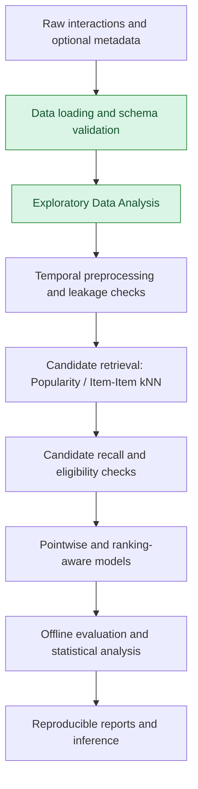

<div align="center">

<sub>APPLIED DATA SCIENCE · RECOMMENDER SYSTEMS · EXPERIMENTAL MACHINE LEARNING</sub>

<h1>Recommender Systems:<br>From Retrieval to Learning-to-Rank</h1>

<p><strong>A reproducible benchmark across collaborative filtering, implicit feedback, and metadata-aware ranking.</strong></p>

<p>
  
  
  
  
  
  
</p>

<p><em>An applied Data Science case study combining reproducible data analysis, recommendation algorithms, and rigorous experimental evaluation.</em></p>

</div>

---

<table>
<thead>
<tr><th colspan="3" align="center">Three Complementary Recommendation Settings</th></tr>
</thead>
<tbody>
<tr>
<td align="center" width="33%"><strong>01 · MovieLens 1M</strong><br><sub>Movie ratings</sub><br><br>Explicit feedback<br>Collaborative filtering<br>Controlled baselines</td>
<td align="center" width="33%"><strong>02 · RetailRocket</strong><br><sub>E-commerce events</sub><br><br>Views, carts, purchases<br>Implicit feedback<br>Sparsity and cold start</td>
<td align="center" width="33%"><strong>03 · Amazon Reviews '23</strong><br><sub>Video Games</sub><br><br>Ratings and timestamps<br>Item metadata<br>Feature-rich ranking</td>
</tr>
</tbody>
</table>

<table>
<tbody>
<tr>
<td align="center" width="25%"><strong>3</strong><br><sub>Data domains</sub></td>
<td align="center" width="25%"><strong>2</strong><br><sub>Recommendation stages</sub></td>
<td align="center" width="25%"><strong>3</strong><br><sub>Modeling paradigms</sub></td>
<td align="center" width="25%"><strong>4</strong><br><sub>Core top-K metrics</sub></td>
</tr>
</tbody>
</table>

<div align="center">
<a href="#-at-a-glance">At a glance</a> ·
<a href="#datasets">Datasets</a> ·
<a href="#-study-design">Study design</a> ·
<a href="#-models-and-evaluation">Models & evaluation</a> ·
<a href="#-step-by-step">Step by step</a> ·
<a href="#-project-structure">Structure</a> ·
<a href="#-data-sources-and-attribution">Sources</a>
</div>

---

## ◆ At a glance

A recommendation model can perform well on a small offline benchmark and still fail to improve a real product. Candidate-generation limitations, temporal leakage, biased observations, cold-start users, and inference costs all affect whether ranking improvements are meaningful.

This project investigates a practical question:

> **When does adding a supervised learning-to-rank stage improve recommendations over simpler retrieval methods—and what does that improvement cost?**

The project follows an applied Data Science workflow:

**Data ingestion → Validation → Exploratory analysis → Temporal splitting → Candidate retrieval → Feature engineering → Learning-to-rank → Offline evaluation → Reproducibility and inference.**

The first three components have been implemented and validated. The remaining components are being developed incrementally.

**The main objectives are to:**

1. Establish strong non-personalized and collaborative-filtering baselines before introducing more complex models.
2. Compare *pointwise* scoring methods with a ranking-specific objective under equivalent experimental conditions.
3. Quantify the effects of candidate recall, engineered features, user/item sparsity, and model complexity.
4. Evaluate model quality alongside statistical uncertainty, computational cost, and operational constraints.
5. Document assumptions, limitations, and failure cases to support transparent and reproducible conclusions.

### Project status

| Component | Status |
|:---|:---|
| Environment and project configuration | ✅ Implemented and tested |
| Dataset ingestion and schema validation | ✅ Implemented and tested |
| Standardized Parquet generation | ✅ Implemented and tested |
| Exploratory Data Analysis | ✅ Implemented and executed |
| Automated tests — ingestion and EDA | ✅ 11 passed |
| Preprocessing and temporal splitting | Planned |
| Candidate retrieval and ranking | Planned |
| Statistical model evaluation | Planned |
| Model serving and inference | Planned |

> [!IMPORTANT]
> **Current milestone — Data Loading, Validation & Exploratory Data Analysis completed.**
>
> All three datasets have been successfully loaded and validated. Their exploratory notebooks have also been executed.
>
> No recommendation benchmark results are claimed at this stage. Model training, ranking comparisons, and inference endpoints remain under development.

---

## Datasets

The project uses three complementary datasets to examine recommendation problems under different feedback mechanisms and data distributions.

Users can reproduce the analyses independently for each dataset. Subsequent model comparisons will be conducted **within each dataset**, rather than combining results into a potentially misleading cross-domain leaderboard.

| Dataset | Source and approximate size | Signal and prediction target | What it helps test |
|:---|:---|:---|:---|
| **MovieLens 1M** | [GroupLens](https://grouplens.org/datasets/movielens/1m/) · ~1 million ratings | Explicit ratings with timestamps; a documented relevance threshold will be defined during preprocessing | Collaborative filtering, popularity, item–item similarity, ranking baselines |
| **RetailRocket** | [RetailRocket on Kaggle](https://www.kaggle.com/datasets/retailrocket/ecommerce-dataset) · 2.76 million events | Views, add-to-cart, and transaction events; separate prediction tasks for interaction and stronger-intent behavior | Implicit feedback, event weighting, sparsity, temporal behavior, and cold start |
| **Amazon Reviews '23 — Video Games** | [McAuley Lab](https://amazon-reviews-2023.github.io/data_processing/5core.html) · ~815 thousand ratings | Explicit ratings and timestamps, with optional [product metadata](https://amazon-reviews-2023.github.io/main.html) | Long-tail behavior, metadata-aware features, and supervised ranking |

### Dataset characteristics

The ingestion and validation pipeline has processed the three datasets successfully.

| Dataset | Interactions | Users | Items |
|:---|---:|---:|---:|
| MovieLens 1M | ~1 million | 6,040 | 3,706 rated movies |
| RetailRocket | 2,756,101 | 1,407,580 | 235,061 |
| Amazon Video Games | 814,586 | 94,762 | 25,612 |

MovieLens counts above describe the published dataset; the full local ingestion completed successfully. RetailRocket and Amazon figures were obtained from the project's validation reports.

### Important dataset-specific considerations

- **MovieLens:** Ratings represent observed preferences, not all items users encountered. Unrated items must not automatically be treated as known negative preferences.
- **RetailRocket:** Views, cart additions, and transactions capture different behavioral signals. The dataset contains repeated user–item interactions that may carry meaningful temporal information.
- **Amazon Video Games:** The loaded files follow the Amazon Reviews 2023 schema. The 5-core provenance remains to be independently confirmed. Product-level metadata association uses `parent_asin`.

The three datasets also differ in sparsity, temporal coverage, user activity, and item popularity. These differences are characterized during the exploratory analysis.

**Local development fixtures:** Small synthetic datasets support automated tests and debugging. They are not used as evidence of recommendation quality.

---

## ◆ Study design

The benchmark combines validated data preparation with a planned two-stage recommendation architecture.



Data loading, validation, and exploratory analysis have been implemented. The remaining stages represent the target experimental workflow.

### 1 · Chronological evaluation

The primary evaluation protocol will use chronological windows with explicitly defined boundaries.

| Window | Purpose | Data-access rule |
|:---|:---|:---|
| **Retrieval history** | Fit candidate generators and historical features | Only interactions available before the prediction context |
| **Ranker training** | Construct labeled candidate groups and train ranking models | Features and candidate snapshots must not use future information |
| **Validation** | Select hyperparameters, thresholds, and ranking strategies | Final test data remain inaccessible |
| **Test** | Evaluate the selected model configuration | No additional tuning after final evaluation |

A per-user leave-last-out protocol may be included as a secondary experiment. Its results will remain separate from those obtained through globally chronological evaluation.

The implementation will explicitly address previously unseen users/items, event availability, and time-dependent metadata.

### 2 · Two-stage recommendation

<table>
<thead>
<tr>
<th width="50%">Stage A — Candidate Retrieval</th>
<th width="50%">Stage B — Re-ranking</th>
</tr>
</thead>
<tbody>
<tr>
<td>
<strong>Objective:</strong> Identify a manageable set of potentially relevant items.<br><br>
<strong>Methods:</strong> Global popularity and item–item collaborative filtering.<br><br>
<strong>Evaluation:</strong> Candidate recall, eligibility, coverage, and computational cost.
</td>
<td>
<strong>Objective:</strong> Order retrieved candidates according to estimated relevance.<br><br>
<strong>Methods:</strong> Logistic Regression, gradient boosting, and LambdaMART.<br><br>
<strong>Evaluation:</strong> Ranking quality, statistical reliability, interpretability, and inference cost.
</td>
</tr>
</tbody>
</table>

Negative examples for supervised ranking will be selected from historically eligible candidates, using documented sampling policies and reproducible random seeds.

In implicit-feedback datasets, unobserved interactions will not be interpreted as confirmed negative preferences.

### 3 · Research questions

| ID | Question | Planned experiment |
|:---|:---|:---|
| **RQ1** | How much relevance is lost during candidate generation? | Candidate Recall@N versus final NDCG@K |
| **RQ2** | Do ranking-specific objectives outperform pointwise classification? | Controlled comparison with equivalent candidate pools |
| **RQ3** | Which feature groups contribute most to ranking quality? | Feature ablation experiments |
| **RQ4** | Under which conditions do recommendation models fail? | Activity, popularity, and cold-start segment analysis |
| **RQ5** | Are ranking improvements worth their computational cost? | Quality versus training cost and inference latency |

---

## ◆ Models and evaluation

### Planned model comparison

| Family | Model | Role |
|:---|:---|:---|
| Heuristic | **Popularity** | Non-personalized baseline and fallback |
| Collaborative filtering | **Item–Item kNN** | Personalized candidate retrieval |
| Pointwise ML | **Logistic Regression** | Interpretable supervised ranking baseline |
| Pointwise ML | **LightGBM / XGBoost Classifiers** | Nonlinear supervised scoring |
| Ranking-aware ML | **LightGBM LambdaMART** | Optimization using grouped ranking examples |

**Primary metric:** `NDCG@10`, calculated separately for each dataset and target definition.

**Supporting metrics:**

- Precision@10, Recall@10, and MAP@10.
- Candidate Recall@N.
- Catalog coverage and user coverage.
- Model training time and inference latency.
- Segment-level performance.
- Statistical confidence intervals where supported by the evaluation protocol.

The planned evaluation will also examine duplicate recommendations, cold-start scenarios, candidate availability, and ranking stability.

**Offline ranking gains do not establish causal improvements in conversions, purchases, or other business KPIs.** Such conclusions require appropriate online experiments or counterfactual evidence.

### Expected experimental artifacts

The completed study is intended to provide:

- Dataset characterization and preprocessing reports.
- Reproducible model configurations and random seeds.
- Model comparison tables with statistical uncertainty.
- Candidate-generation diagnostics.
- Feature-importance and ablation analyses.
- Documented limitations and failure cases.
- A reproducible inference pipeline and demonstration API.

The EDA notebooks and descriptive visualizations are already available. Model comparison and inference artifacts will be introduced in subsequent stages.

---

## ◆ Step by step

The following steps document how users can reproduce the current analyses and, as development progresses, the complete recommendation benchmark.

**Implementation status:** Steps 1–4 are implemented. Steps 5–7 describe the planned model development and evaluation workflow.

### Step 1 — Create the Python environment · implemented and tested

**Requirements:** Python 3.11+ and sufficient local memory for the selected dataset.

Users configure an isolated Python environment and install the project's dependencies.

```bash
python3 -m venv .venv
source .venv/bin/activate

python -m pip install --upgrade pip
python -m pip install -r requirements.txt
python -m pip install -e . --no-deps
```

On Windows, users activate the environment using `.venv\Scripts\activate`.

The editable installation makes the `recsys` package available to scripts and notebooks while allowing source-code changes without repeated installation.

> **macOS note:** LightGBM may require the OpenMP runtime (`brew install libomp`).

**Verified environments:** The data ingestion and initial tests were executed using Python 3.12.9. Subsequent development and the complete 11-test suite were executed successfully on macOS using Python 3.13.2.

#### Jupyter kernel configuration

Users running JupyterLab should ensure that the notebook kernel uses the same Python environment in which the project dependencies are installed.

They can register the environment as a dedicated Jupyter kernel:

```bash
python -m pip install ipykernel

python -m ipykernel install --user \
  --name recsys-benchmark \
  --display-name "Python (Recsys Benchmark)"
```

After registration, users select **Python (Recsys Benchmark)** in JupyterLab.

This configuration avoids inconsistencies caused by different Python installations or virtual environments.

### Step 2 — Obtain and organize the datasets · implemented and verified

Users obtain the datasets from the original publishers linked in the [Datasets](#datasets) section.

The raw source files follow this structure:

```text
data/
└── raw/
    ├── movielens-1m/
    │   └── ml-1m/
    │       ├── ratings.dat
    │       ├── movies.dat
    │       └── users.dat
    │
    ├── retailrocket/
    │   ├── events.csv
    │   ├── category_tree.csv
    │   ├── item_properties_part1.csv
    │   └── item_properties_part2.csv
    │
    └── amazon-video-games/
        ├── Video_Games.csv
        └── meta_Video_Games.jsonl.gz
```

The dataset adapters recognize the original file formats and produce a standardized event representation.

They preserve:

- Original user and item identifiers.
- Explicit ratings and implicit interaction types.
- UTC timestamps.
- Source attributes and traceability information.
- Auxiliary metadata, when available.

The adapters do not remove repeated interactions, assign relevance labels, or join future metadata during ingestion.

**Data management:** Original datasets remain unchanged and are excluded from version control. Generated data are stored separately under `data/processed/`.

### Step 3 — Validate and prepare the datasets · implemented and tested

The preparation pipeline includes dataset-specific loaders, schema validation, descriptive statistics, and Parquet export.

Users execute the pipeline through `scripts.prepare_data`.

#### 3.1 — Preliminary validation

A limited number of records can be used to verify dataset compatibility before full processing.

**MovieLens 1M**

```bash
python -m scripts.prepare_data \
  --dataset movielens-1m \
  --max-rows 10000 \
  --validate-only
```

**RetailRocket**

```bash
python -m scripts.prepare_data \
  --dataset retailrocket \
  --max-rows 10000 \
  --validate-only
```

**Amazon Video Games**

```bash
python -m scripts.prepare_data \
  --dataset amazon-video-games \
  --max-rows 10000 \
  --validate-only
```

The `--validate-only` option generates a report without exporting processed data.

The `--max-rows` option selects the first N records rather than a statistically representative sample. It is intended for technical verification and debugging.

All three datasets successfully passed preliminary validation using 10,000 interaction records each.

#### 3.2 — Full dataset preparation

Users process the complete datasets using:

```bash
python -m scripts.prepare_data --dataset movielens-1m

python -m scripts.prepare_data --dataset retailrocket

python -m scripts.prepare_data --dataset amazon-video-games
```

The preparation pipeline validates the data and exports standardized event logs to Parquet.

#### 3.3 — Validation results

The full preparation workflow has been executed successfully for all three datasets.

The RetailRocket validation report identified:

- **2,756,101 interactions**, including views, cart additions, and transactions.
- **1,407,580 users** and **235,061 items**.
- **610,922 repeated user–item interactions**.
- **460 potentially duplicated event observations**, retained for subsequent analysis.
- No missing or invalid timestamps.

The Amazon Video Games validation report identified:

- **814,586 ratings**.
- **94,762 users** and **25,612 items**.
- No repeated user–item pairs or duplicate event observations detected.
- No missing or invalid timestamps.

MovieLens 1M also completed full validation and preparation successfully.

These results establish the operational correctness of the ingestion pipeline for the checked conditions. They do not establish the absence of selection bias, temporal leakage, or other methodological limitations.

#### 3.4 — Generated artifacts

The preparation pipeline produces:

```text
data/processed/
├── movielens-1m/
│   ├── events.parquet
│   ├── movies.parquet
│   ├── users.parquet
│   └── validation.json
│
├── retailrocket/
│   ├── events.parquet
│   ├── categories.parquet
│   └── validation.json
│
└── amazon-video-games/
    ├── events.parquet
    └── validation.json
```

The Parquet files contain standardized events and available reference tables.

The JSON reports document:

- Dataset dimensions and schema validation.
- User/item counts and interaction frequencies.
- Temporal coverage and missing timestamps.
- Duplicate and repeated-event observations.
- Interaction sparsity and feedback distributions.
- Validation warnings and source information.

Time-dependent RetailRocket item properties and the full Amazon metadata catalog remain separate for subsequent feature engineering.

### Step 4 — Perform exploratory data analysis · implemented and executed

The Exploratory Data Analysis stage characterizes the datasets before defining relevance targets, temporal splits, retrieval strategies, or ranking models.

Users can examine the statistical properties of each dataset through three dedicated Jupyter notebooks.

The implementation separates analytical computations from visual presentation:

- `src/recsys/eda.py` provides reusable statistical analyses.
- `src/recsys/eda_plots.py` provides reusable plotting functions.
- Individual notebooks present dataset-specific hypotheses, visualizations, and interpretations.

The analytical functions use **DuckDB** to query Parquet files directly, reducing the need to load complete datasets into pandas memory.

#### 4.1 — Available notebooks

| Notebook | Dataset | Analytical focus |
|:---|:---|:---|
| [`01_movielens_eda.ipynb`](notebooks/01_movielens_eda.ipynb) | MovieLens 1M | Explicit ratings, user activity, item popularity, long-tail behavior |
| [`02_retailrocket_eda.ipynb`](notebooks/02_retailrocket_eda.ipynb) | RetailRocket | Implicit feedback, repeated interactions, sparsity, temporal behavior |
| [`03_amazon_eda.ipynb`](notebooks/03_amazon_eda.ipynb) | Amazon Video Games | Rating distributions, popularity concentration, temporal coverage, cold start |

All three notebooks have been executed successfully using the prepared datasets.

#### 4.2 — Analysis methodology

The notebooks follow a consistent analytical structure:

1. **Data provenance and validation:** They review dataset characteristics and quality reports.
2. **Feedback distribution:** They examine explicit ratings and implicit event types without prematurely defining relevance.
3. **User and item activity:** They characterize frequency distributions, activity quantiles, and long-tail behavior.
4. **Popularity concentration:** They measure the share of interactions associated with the most active 1% and 10% of items.
5. **Temporal dynamics:** They analyze monthly interaction volumes and changes in observed activity.
6. **Cold-start diagnostics:** They identify subsequent events involving previously unseen users or items under a diagnostic global cutoff.
7. **Scientific interpretation:** They relate the observed statistical properties to future preprocessing and modeling decisions.

The notebooks use shared analytical functions to maintain methodological consistency across datasets.

#### 4.3 — Exploratory hypotheses

**MovieLens 1M**

The analyses examine whether user and movie activity follow long-tailed distributions, how explicit ratings are distributed, and how temporal availability influences recommendation eligibility.

These observations will inform relevance thresholds, collaborative filtering baselines, and evaluation policies.

**RetailRocket**

The analyses examine differences among views, cart additions, and transactions, with particular attention to sparse histories, repeated interactions, and temporal changes.

These characteristics will inform implicit-feedback definitions, candidate generation, and cold-start handling.

**Amazon Video Games**

The analyses examine product popularity concentration, user activity, historical coverage, and potential selection effects associated with 5-core filtering.

These observations will inform metadata-aware features and temporal evaluation strategies.

The notebooks report statistics calculated from the processed datasets; they do not claim predictive performance at this stage.

#### 4.4 — Notebook execution

Users can generate the original notebook templates using:

```bash
python -m scripts.build_eda_notebooks
```

> **Note:** The generator overwrites the three notebook files. Users who have added results or interpretations should preserve their changes before regenerating them.

Users start JupyterLab from the project environment:

```bash
python -m jupyter lab
```

They then open the notebooks and execute their cells using the configured Python kernel.

The project package must remain accessible to the notebook environment through the editable installation described in Step 1.

#### 4.5 — Generated visualizations

The notebook workflows generate figures under `reports/figures/`, organized by dataset.

```text
reports/
└── figures/
    ├── movielens-1m/
    │   ├── feedback_mix.png
    │   ├── ratings.png
    │   ├── users_activity.png
    │   ├── items_activity.png
    │   ├── monthly_volume.png
    │   └── cold_start.png
    │
    ├── retailrocket/
    │   ├── feedback_mix.png
    │   ├── users_activity.png
    │   ├── items_activity.png
    │   ├── monthly_volume.png
    │   └── cold_start.png
    │
    └── amazon-video-games/
        ├── feedback_mix.png
        ├── ratings.png
        ├── users_activity.png
        ├── items_activity.png
        ├── monthly_volume.png
        └── cold_start.png
```

The figures illustrate observed distributions and dataset characteristics. They will support subsequent preprocessing decisions and the final experimental report.

#### 4.6 — Methodological considerations

The EDA explicitly distinguishes descriptive analysis from predictive evaluation.

- **Sparsity** represents the proportion of unobserved user–item pairs, not the proportion of negative preferences.
- **Popularity** represents interaction frequency, not causal relevance or item quality.
- **Cold-start diagnostics** identify users and items not previously observed under a selected global time cutoff.
- **Temporal patterns** may reflect user behavior, source coverage, or changes in data collection.
- **Approximate quantiles** provide scalable distribution summaries but should not be confused with exact statistics.

The cold-start analysis uses an exploratory cutoff based on the 80th percentile of event timestamps. This diagnostic does not replace the definitive train/validation/test protocol.

#### 4.7 — Automated testing

The project includes synthetic tests for data loading, validation, and exploratory analysis.

Users execute the complete test suite using:

```bash
python -m pytest tests/ -v
```

The tests verify:

- Dataset loading and preservation of source attributes.
- Identifier and timestamp validation.
- Handling of repeated interactions.
- Metadata and schema compatibility.
- Aggregated activity and event counts.
- Item popularity concentration.
- Temporal cold-start classification.
- Rejection of invalid diagnostic parameters.

**Verified result:** `11 passed in 1.02s` on macOS using Python 3.13.2.


### 4.8 — Exploratory findings

The three datasets have been analyzed to characterize feedback distributions, user/item activity, temporal behavior, and cold-start exposure.

The results reveal distinct modeling challenges: MovieLens emphasizes explicit preferences and new-user exposure under chronological evaluation; RetailRocket exhibits highly sparse histories and predominantly implicit feedback; and Amazon Video Games presents concentrated high ratings and substantial new-item exposure.

These findings provide the empirical foundation for subsequent preprocessing, retrieval, and learning-to-rank experiments.

**[Explore the complete EDA report →](reports/eda/README.md)**


### Step 5 — Prepare modeling data and retrieval baselines · planned

The next implementation stage will transform standardized event data into modeling-ready datasets.

It will introduce:

- Explicit and implicit feedback policies.
- Chronological train/validation/test partitioning.
- Prevention of temporal information leakage.
- Unknown-user/item handling.
- Popularity and item–item kNN baselines.
- Candidate-generation and coverage diagnostics.

The final CLI commands for this stage will be documented when the corresponding modules are implemented and tested.

### Step 6 — Train and compare ranking models · planned

The ranking stage will compare pointwise scoring methods with ranking-aware objectives.

It will include:

- Feature engineering and temporal feature availability.
- Logistic Regression and gradient-boosted classifiers.
- LightGBM LambdaMART.
- Equivalent candidate pools for controlled comparisons.
- Validation-based hyperparameter selection.
- Feature ablation and error analysis.

Model evaluation will use a final test set that remains separate from model selection.

### Step 7 — Reproduce the complete benchmark · planned

The final stage will integrate retrieval, ranking, and statistical evaluation across all three datasets.

The expected outputs include:

- Per-dataset benchmark tables.
- Statistical confidence intervals.
- Candidate coverage and segment diagnostics.
- Feature-ablation results.
- Training and inference performance measurements.
- Reproducible configuration files and technical reports.

Results will be interpreted within their respective dataset and prediction-task definitions.

**Absolute NDCG values across different datasets must not be interpreted as a single comparative leaderboard.**

---

## ◆ Project structure

The project follows a modular Python package structure, separating reusable analytical components, dataset-specific adapters, notebooks, tests, and generated artifacts.

```text
recsys-ranking-benchmark/
├── README.md
├── requirements.txt
├── pyproject.toml
├── .gitignore
│
├── data/
│   ├── README.md
│   ├── raw/                         # Original datasets; gitignored
│   └── processed/                   # Generated Parquet data; gitignored
│
├── src/
│   └── recsys/
│       ├── __init__.py
│       ├── data.py
│       ├── validation.py
│       ├── utils.py
│       ├── eda.py
│       ├── eda_plots.py
│       └── datasets/
│           ├── __init__.py
│           ├── movielens.py
│           ├── retailrocket.py
│           └── amazon.py
│
├── scripts/
│   ├── __init__.py
│   ├── prepare_data.py
│   └── build_eda_notebooks.py
│
├── notebooks/
│   ├── 01_movielens_eda.ipynb
│   ├── 02_retailrocket_eda.ipynb
│   └── 03_amazon_eda.ipynb
│
├── tests/
│   ├── test_loading.py
│   └── test_eda.py
│
└── reports/
    └── figures/
        ├── movielens-1m/
        ├── retailrocket/
        └── amazon-video-games/
```

Additional modules for preprocessing, temporal splitting, candidate retrieval, ranking, evaluation, and inference will be incorporated as subsequent stages are implemented.

**Implementation principle:** Reusable computational logic remains in Python modules, while notebooks focus on analysis, visualization, and interpretation. This separation supports testing, maintainability, and reproducibility.

---

## ◆ Data sources and attribution

The project uses publicly available datasets obtained from their original publishers. Source links and dataset descriptions are provided in the [Datasets](#datasets) section.

Original datasets are not redistributed through this repository. Users are responsible for obtaining the files from the original sources and respecting their respective usage and redistribution conditions.

The repository distinguishes source data, generated analytical artifacts, and experimental conclusions to maintain transparent data provenance.
