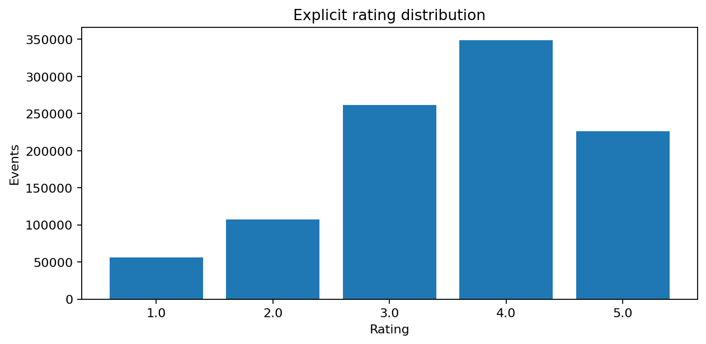
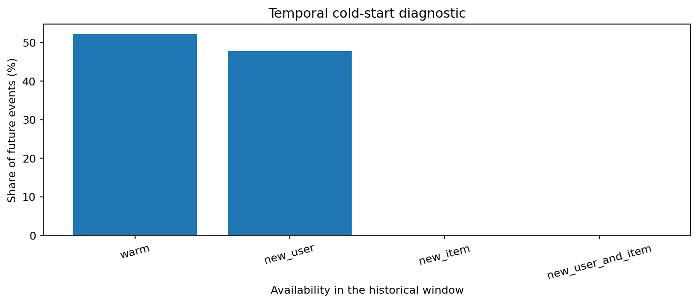
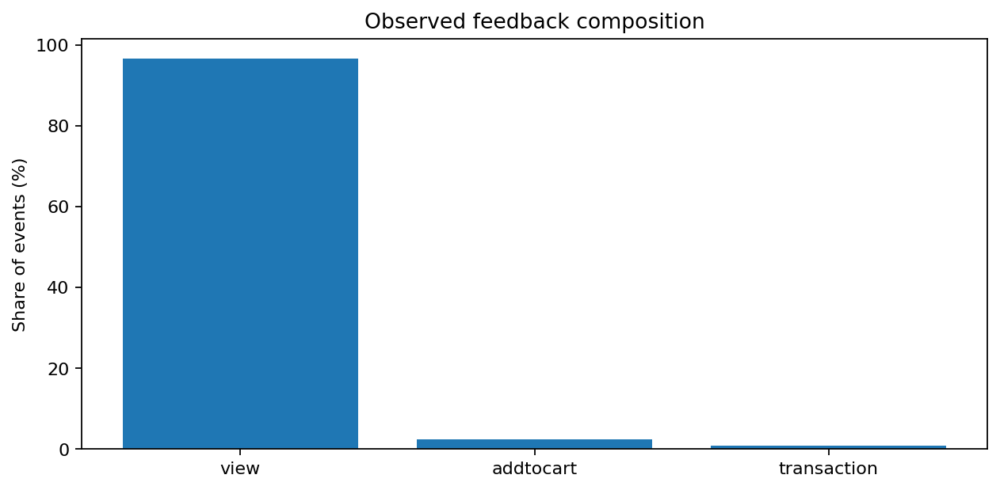
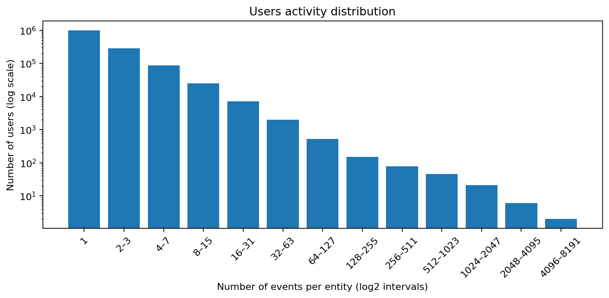
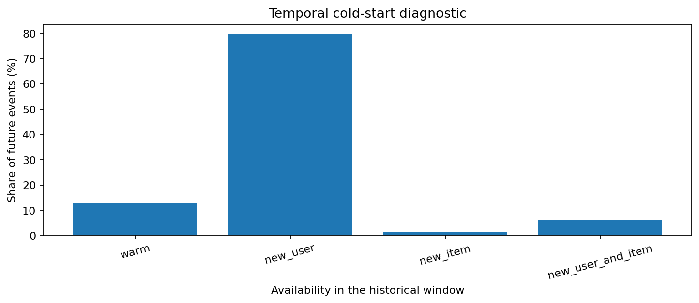
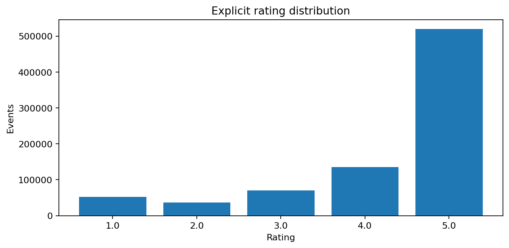
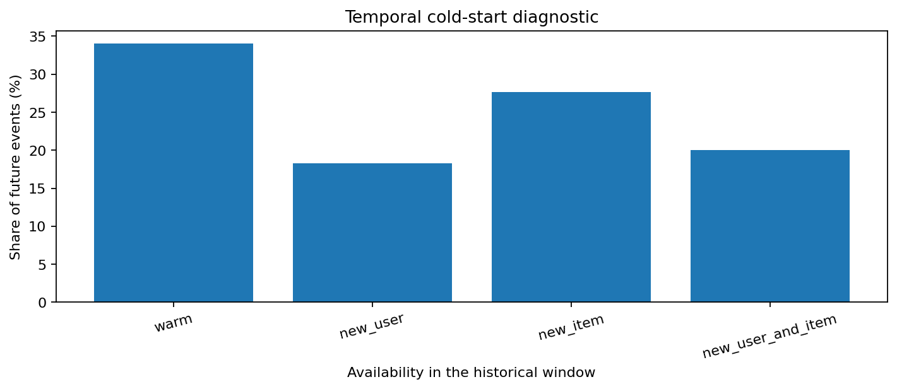

<div align="center">

<sub>APPLIED DATA SCIENCE · EXPLORATORY ANALYSIS · RECOMMENDER SYSTEMS</sub>

<h1>Exploratory Data Analysis:<br>Three Recommendation Datasets</h1>

<p><strong>Understanding feedback, sparsity, popularity, temporal behavior, and cold-start exposure before model development.</strong></p>

<p>
  
  
  
  
</p>

<p><em>Results from MovieLens 1M, RetailRocket, and Amazon Video Games.</em></p>

</div>

---

<div align="center">

[Overview](#-at-a-glance) ·
[MovieLens](#-movielens-1m) ·
[RetailRocket](#-retailrocket) ·
[Amazon](#-amazon-video-games) ·
[Comparison](#-cross-dataset-findings) ·
[Reproducibility](#-reproducibility)

</div>

## ◆ At a glance

Recommendation datasets often share similar user–item structures while representing substantially different behavioral processes. Explicit ratings, product views, and purchase-related events provide different forms of evidence about user preferences.

This exploratory study investigates three questions:

1. **How do user activity, item popularity, and feedback distributions differ across recommendation domains?**
2. **How does temporal availability affect the proportion of interactions involving previously unseen users or items?**
3. **Which characteristics should influence subsequent preprocessing, candidate retrieval, and ranking strategies?**

The analyses use standardized Parquet datasets produced by the project's ingestion and validation pipeline.

They examine observed distributions, identify methodological risks, and translate descriptive evidence into modeling considerations.

### Dataset overview

| Dataset | Interactions | Users | Items | Feedback |
|:---|---:|---:|---:|:---|
| **MovieLens 1M** | ~1 million | 6,040 | 3,706 rated movies | Explicit ratings |
| **RetailRocket** | 2,756,101 | 1,407,580 | 235,061 | Views, carts, transactions |
| **Amazon Video Games** | 814,586 | 94,762 | 25,612 | Explicit ratings |

MovieLens values describe the published dataset. RetailRocket and Amazon counts come from the completed local validation reports.

### Three distinct analytical challenges

<table>
<tr>
<td align="center" width="33%">
<strong>01 · Preference Modeling</strong><br>
<sub>MovieLens 1M</sub><br><br>
Explicit ratings<br>
Observed preference bias<br>
Collaborative filtering
</td>
<td align="center" width="33%">
<strong>02 · Behavioral Modeling</strong><br>
<sub>RetailRocket</sub><br><br>
Implicit feedback<br>
Sparse user histories<br>
New-user exposure
</td>
<td align="center" width="33%">
<strong>03 · Temporal Generalization</strong><br>
<sub>Amazon Video Games</sub><br><br>
Rating concentration<br>
New-item exposure<br>
Metadata-aware modeling
</td>
</tr>
</table>

> [!IMPORTANT]
> **Scope of the findings.** The analyses characterize observed interactions rather than predictive performance. They do not establish recommendation quality, business impact, or causal relationships.

---

## ◆ MovieLens 1M

**Analytical focus:** Explicit feedback, user activity, item popularity, and temporal availability.

[Explore the MovieLens notebook](../../notebooks/01_movielens_eda.ipynb)

### 1. Explicit rating behavior

MovieLens contains explicit user ratings on a five-point scale.

The observed distribution is not uniform. Ratings of **4 stars are the most frequent**, followed by 3- and 5-star ratings. Lower ratings occur less frequently.



**Interpretation.** The observed concentration of moderate-to-high ratings suggests that feedback transformation requires careful consideration.

For example, a binary relevance definition based on ratings of 4 or 5 may be useful for top-K recommendation experiments. However, such a transformation discards distinctions among rating values and changes the learning objective.

Unrated items must not automatically be interpreted as negative preferences because the dataset does not provide a complete record of which movies users encountered.

**Modeling implications**

- They should preserve the original rating values during preprocessing.
- They should document and evaluate the effects of any relevance threshold.
- They should avoid treating missing ratings as confirmed negative feedback.

### 2. Temporal cold-start exposure

The temporal diagnostic divides observed interactions into a historical window and a subsequent evaluation window using a global event-time cutoff.



Approximately **52% of subsequent events involve previously observed users and items**, while **48% involve users who were not present in the historical window**.

The plot shows negligible new-item exposure under this particular cutoff.

**Interpretation.** Although the dataset contains many ratings per user, a globally chronological evaluation can still produce substantial new-user exposure.

This finding is particularly relevant when comparing evaluation strategies. A per-user leave-last-out partition may emphasize warm-user recommendation, while a global chronological partition may expose a substantially different operational challenge.

The historical concentration of ratings around 2000 also suggests that timestamp distributions and collection procedures deserve attention before finalizing evaluation windows.

**Modeling implications**

- They should distinguish warm-user evaluation from new-user fallback scenarios.
- They should investigate the effects of chronological and per-user partitioning.
- They should avoid inferring production cold-start rates directly from this retrospective dataset.

### Additional diagnostics

The notebook also documents:

| Analysis | Figure |
|:---|:---|
| User activity distribution | [View figure](../figures/movielens-1m/users_activity.png) |
| Item popularity distribution | [View figure](../figures/movielens-1m/items_activity.png) |
| Historical interaction volume | [View figure](../figures/movielens-1m/monthly_volume.png) |

**Key takeaway:** MovieLens provides a useful foundation for collaborative filtering and supervised ranking, but explicit-feedback selection and temporal evaluation design require careful treatment.

---

## ◆ RetailRocket

**Analytical focus:** Implicit feedback, sparse interaction histories, repeated behavior, and new-user exposure.

[Explore the RetailRocket notebook](../../notebooks/02_retailrocket_eda.ipynb)

### 1. Strong imbalance among behavioral events

RetailRocket contains three observed event types:

| Event | Observations |
|:---|---:|
| View | 2,664,312 |
| Add to cart | 69,332 |
| Transaction | 22,457 |

Product views represent approximately **96.7% of recorded events**, while cart additions and transactions account for substantially smaller proportions.



**Interpretation.** The substantial imbalance between event types suggests that the definition of relevance will strongly influence the learning task.

Treating every event as equivalent would ignore meaningful differences in behavioral intent. Conversely, focusing exclusively on transactions would substantially reduce the amount of positive feedback available for training.

The relative frequency of these events does not establish a conversion rate, since the visualization does not reconstruct user exposure sequences or attribute transactions to individual views.

**Modeling implications**

- They should distinguish interaction prediction from stronger-intent prediction.
- They should evaluate event-specific relevance definitions.
- They should account for label imbalance and the limitations of implicit feedback.

### 2. Highly sparse user activity

The dataset contains more than 1.4 million users, and the user activity distribution is strongly concentrated among short interaction histories.



The largest group consists of users with only one observed event. The number of users decreases substantially as interaction counts increase.

**Interpretation.** Collaborative recommendation methods require sufficient historical interactions to estimate meaningful user preferences.

For users with limited histories, item–item collaborative signals may be weak or unavailable. This creates a practical challenge for candidate generation and personalized ranking.

The dataset also contains repeated user–item events, which may provide useful information about engagement intensity and temporal behavior.

**Modeling implications**

- They should evaluate performance by user activity level.
- They should preserve repeated interactions until a documented aggregation policy is established.
- They should consider non-personalized or context-aware candidate generation for users with limited histories.

### 3. Temporal cold-start exposure



The diagnostic indicates that approximately **80% of subsequent events involve previously unseen users interacting with known items**.

A further proportion of events involves users and items that are both previously unseen.

Only approximately **13% of subsequent events belong to the warm-user/warm-item segment**.

**Interpretation.** New-user exposure is a central characteristic of this dataset under the selected temporal cutoff.

As a result, a benchmark limited to users with sufficient interaction history could exclude a substantial portion of the observed event stream.

The measured proportions are specific to the dataset and cutoff. They should not be interpreted as estimates of new-user rates in all e-commerce environments.

**Modeling implications**

- They should report user coverage alongside ranking quality.
- They should implement explicit fallback strategies for new users.
- They should distinguish personalized recommendation performance from overall system eligibility.

### Additional diagnostics

| Analysis | Figure |
|:---|:---|
| Item popularity distribution | [View figure](../figures/retailrocket/items_activity.png) |
| Monthly event evolution | [View figure](../figures/retailrocket/monthly_volume.png) |

The temporal analysis covers several months of 2015. The first and last observed months are incomplete; therefore, differences in monthly volume should not be interpreted as evidence of seasonal demand changes without additional investigation.

**Key takeaway:** RetailRocket demonstrates why implicit-feedback recommendation requires explicit target definitions, robust candidate generation, and separate evaluation of users with limited historical activity.

---

## ◆ Amazon Video Games

**Analytical focus:** Rating distributions, popularity concentration, temporal variation, and new-item exposure.

[Explore the Amazon notebook](../../notebooks/03_amazon_eda.ipynb)

### 1. Concentration of high ratings

The Amazon Video Games dataset contains more than 814 thousand explicit ratings spanning a long historical period.

The observed rating distribution is strongly concentrated at the highest value.



Five-star ratings represent the largest category by a substantial margin.

**Interpretation.** A pronounced concentration of high ratings affects supervised learning objectives and the interpretation of relevance.

A threshold such as rating ≥ 4 may produce a highly imbalanced relevance-label distribution. This would need to be considered when selecting classification objectives, negative sampling policies, and ranking metrics.

The prevalence of positive ratings among submitted reviews does not establish the proportion of products that all users would consider relevant.

**Modeling implications**

- They should measure the class balance produced by candidate relevance thresholds.
- They should compare alternative feedback representations before selecting the final objective.
- They should avoid interpreting observed rating frequencies as unbiased preference probabilities.

### 2. Substantial new-item exposure



The temporal diagnostic reveals four substantial segments:

| Segment | Approximate share of subsequent events |
|:---|---:|
| Warm users and items | 34% |
| New users, known items | 18% |
| Known users, new items | 28% |
| New users and new items | 20% |

Approximately **48% of subsequent events involve at least one previously unseen item**.

**Interpretation.** This dataset presents a different cold-start profile from MovieLens and RetailRocket.

New-item exposure is particularly relevant because collaborative models cannot estimate historical interaction patterns for items that have not previously appeared.

Product metadata, where available and temporally appropriate, may provide complementary information for generating or ranking new-item candidates.

The observed pattern also motivates segment-level evaluation: aggregate ranking metrics could conceal important differences between warm-item and new-item scenarios.

**Modeling implications**

- They should distinguish collaborative and metadata-assisted recommendation.
- They should evaluate new-item performance separately from warm-item performance.
- They should verify product identifiers and temporal feature availability before constructing metadata-based features.

### Additional diagnostics

| Analysis | Figure |
|:---|:---|
| User activity distribution | [View figure](../figures/amazon-video-games/users_activity.png) |
| Item popularity distribution | [View figure](../figures/amazon-video-games/items_activity.png) |
| Historical interaction volume | [View figure](../figures/amazon-video-games/monthly_volume.png) |

The temporal series spans more than two decades and exhibits substantial variation in observed review activity. These changes may reflect platform adoption, sampling procedures, or collection coverage; the EDA alone cannot identify their causes.

The source follows the Amazon Reviews 2023 schema. However, the exact 5-core selection procedure has not been independently verified from the loaded file provenance.

**Key takeaway:** Amazon Video Games offers a useful setting for investigating metadata-aware recommendation and the differences between warm-item and new-item ranking.

---

## ◆ Cross-dataset findings

The three datasets differ in both feedback semantics and the availability of historical user/item information.

### 1. Temporal cold-start comparison

The following table summarizes the diagnostic cold-start segments across the three datasets.

| Dataset | Warm | New user | New item | Both new |
|:---|---:|---:|---:|---:|
| **MovieLens 1M** | ~52% | ~48% | ~0% | ~0% |
| **RetailRocket** | ~13% | ~80% | ~1% | ~6% |
| **Amazon Video Games** | ~34% | ~18% | ~28% | ~20% |

*Values are approximate readings of the generated figures. They represent shares of subsequent events, not shares of distinct users or items.*

**Methodology:** The diagnostic uses a global timestamp corresponding approximately to the 80th percentile of observed event times. Users and items are classified according to whether they appeared at or before this cutoff.

The four categories are mutually exclusive:

- **Warm:** Both user and item appeared previously.
- **New user:** Only the item appeared previously.
- **New item:** Only the user appeared previously.
- **Both new:** Neither appeared previously.

The same diagnostic definition is applied to the three datasets, but the actual cutoff date differs because their temporal distributions differ.

> [!NOTE]
> This analysis characterizes temporal exposure. It is not a train/validation/test split and does not measure predictive performance. Exact percentages can be reproduced from the corresponding notebook outputs.

### 2. Implications for recommendation modeling

| Dimension | MovieLens 1M | RetailRocket | Amazon Video Games |
|:---|:---|:---|:---|
| Feedback | Explicit ratings | Implicit behavior | Explicit ratings |
| Main challenge | Observed preference bias and temporal user availability | Sparse histories and new-user exposure | Rating concentration and new-item exposure |
| Relevant baselines | Popularity, item–item kNN | Popularity, behavior-aware retrieval | Popularity, item–item kNN |
| Feature opportunities | User history, item similarity, movie metadata | Event frequency, recency, behavioral context | Product attributes, historical popularity, user–item affinities |
| Evaluation emphasis | Relevance and warm/cold-user segments | User coverage, candidate recall, event-specific targets | Warm/new-item quality and metadata contribution |

### 3. Main methodological conclusions

**Feedback semantics must determine the prediction task.** Explicit ratings and implicit behavioral events should not be converted into relevance targets using an undocumented common policy.

**Candidate generation must reflect the available history.** The strong variation in cold-start exposure suggests that a single personalized retrieval strategy may not serve every evaluation segment equally well.

**Temporal evaluation must precede feature engineering.** Historical user/item statistics and time-dependent metadata must be constructed without future information.

**Ranking quality must be interpreted alongside coverage.** A model may achieve strong ranking metrics among eligible users while failing to generate meaningful recommendations for a large part of the observed population.

**Cross-dataset comparisons should focus on methodological robustness.** Absolute recommendation scores are not directly comparable when feedback mechanisms, candidate spaces, and target definitions differ.

---

## ◆ Limitations

The exploratory findings support experimental design, but they do not establish the effectiveness of any recommendation algorithm.

Several limitations remain:

1. **Observational feedback:** Interactions are influenced by which items were exposed to users, and missing interactions do not necessarily indicate negative preferences.
2. **Retrospective timestamps:** Recorded activity can reflect historical collection and selection procedures rather than production traffic patterns.
3. **Cold-start sensitivity:** Diagnostic percentages depend on the selected cutoff and should not be treated as universal dataset properties.
4. **Metadata availability:** RetailRocket item properties require time-aware joins, while Amazon product attributes require validated identifiers and availability assumptions.
5. **Dataset provenance:** The Amazon 5-core filtering procedure requires independent provenance verification.


---

## ◆ Reproducibility

### Prerequisites

The analyses require the project dependencies, a working Jupyter kernel, and the three original datasets organized according to the [main project README](../../README.md).

Users prepare the validated Parquet datasets with:

```bash
python -m scripts.prepare_data --dataset movielens-1m
python -m scripts.prepare_data --dataset retailrocket
python -m scripts.prepare_data --dataset amazon-video-games
```

They verify the reusable analytical modules with:

```bash
python -m pytest tests/ -v
```

They then launch JupyterLab:

```bash
python -m jupyter lab
```

### Analytical notebooks

| Dataset | Notebook |
|:---|:---|
| MovieLens 1M | [01_movielens_eda.ipynb](../../notebooks/01_movielens_eda.ipynb) |
| RetailRocket | [02_retailrocket_eda.ipynb](../../notebooks/02_retailrocket_eda.ipynb) |
| Amazon Video Games | [03_amazon_eda.ipynb](../../notebooks/03_amazon_eda.ipynb) |

The notebooks use shared functions from:

- `src/recsys/eda.py`
- `src/recsys/eda_plots.py`

They perform scalable analytical queries over Parquet data with DuckDB and generate descriptive figures using Matplotlib.

### Figure organization

The original figures are stored under:

```text
reports/
├── eda/
│   └── README.md
│
└── figures/
    ├── movielens-1m/
    ├── retailrocket/
    └── amazon-video-games/
```

The report embeds selected figures using relative paths. The complete set of diagnostic figures remains available in the corresponding dataset directories.

**Reproducibility status:** The ingestion and EDA stages have been executed successfully, and the automated test suite reports 11 passing tests.

---

<div align="center">

<sub>Descriptive evidence first. Reproducible experiments next.</sub>

[Back to the main project](../../README.md)

</div>
